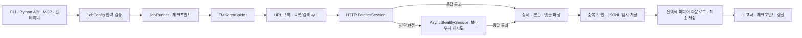

# FMKorea Scraper

Scrapling 기반 에펨코리아 게시글·댓글 수집기입니다. 게시글 직접 수집, 게시판 목록·검색, 통합·심층 검색, 범위 수집, 실시간 수집을 지원합니다. 제품 동작과 옵션의 기준은 [기능명세서](docs/FMKorea-Scraper_Function_Specification.md)이며, CLI·환경변수의 정확한 계약은 명세서 §8.2를 따릅니다.

## 빠른 시작

Python 3.11 이상이 필요합니다. 아래 예시는 Windows PowerShell과 프로젝트 루트 기준입니다.

```powershell
python -m venv .venv
.\.venv\Scripts\python -m pip install -e ".[test]"
.\.venv\Scripts\scrapling install
.\.venv\Scripts\fmkorea-scraper run --source board-search --board-id stock --keyword '코스피' --page-start 1 --page-end 1 --output-path .
```

`scrapling install`은 차단 시 사용하는 브라우저 런타임을 설치합니다. 테스트 도구가 필요 없으면 `pip install -e .`을 사용할 수 있습니다. `fmkorea-scraper` 대신 `python main.py` 또는 `python -m fmkorea_scraper.adapters.cli`로 같은 CLI를 실행할 수 있습니다. 예: `python main.py run --source ...`. 이후 예시에서는 `fmkorea-scraper`를 사용합니다.

현재 작업 디렉터리의 `.env`에 `FMKOREA_PROXY_HOST`가 설정되어 있으면 자동으로 프록시를 사용합니다. 직접 연결을 원하면 해당 설정을 비운 실행 환경에서 시작합니다.

## 실행 구조와 수집 워크플로



1. `adapters/`가 CLI 인자 또는 API 입력을 `models/`의 `JobConfig`, 수집·실행·저장 옵션으로 검증합니다.
2. `application/jobs.py`의 `JobRunner`가 작업 ID, 실행 ID, 출력 저장소와 체크포인트를 준비합니다. 목록·검색 URL은 `collect/urls.py`의 규칙으로 만듭니다. 직접 게시글 수집을 제외하면 게시글 URL을 미리 모을 필요가 없습니다.
3. `spider/fmkorea.py`가 목록/검색 페이지에서 후보를 찾고 상세 페이지를 요청합니다. `collect/`는 후보·URL을, `parse/`는 게시글 메타데이터·본문·첨부·댓글을 처리합니다. 추가 댓글 페이지는 `--max-comment-pages`로 요청할 수 있으며 기본값에서는 상세 페이지의 댓글만 수집합니다.
4. 요청이 차단으로 판정되면 같은 프록시의 Scrapling `AsyncStealthySession`으로 재시도합니다. 브라우저에서도 차단되면 다음 논리 시도에서 프록시 풀을 회전합니다. 기본 `--max-blocked-retries 3`의 순서는 `HTTP(P1) → Browser(P1) → HTTP(P2) → Browser(P2)`입니다. 단일 프록시라면 두 번째 시도도 같은 프록시를 사용합니다. 이 값은 전송 오류 재시도 횟수와 별개입니다.
5. 게시글은 중복 키를 확인해 JSONL 임시 저장소에 기록합니다. 수집이 끝나면 요청한 경우 미디어를 다운로드하고 최종 JSONL과 `report.json`을 만듭니다. 파싱 실패는 `failures.jsonl`에 기록합니다. 차단으로 중단된 작업도 정상 종료 경로를 거치면 `status: stopped` 보고서를 만듭니다. 프로세스가 강제 종료되거나 보고서 작성 전에 예외가 나면 보고서가 없을 수 있습니다.

브라우저 세션에는 코드에서 캔버스 지문 숨김, WebRTC 차단, Cloudflare 해결 등의 옵션을 설정합니다. 이 브라우저는 **스크래퍼의 Scrapling Browser Fallback**입니다. 개발자가 사이트를 탐색하거나 브라우저 테스트를 할 때는 [AGENTS.md](AGENTS.md)에 따라 `$agent-browser`를 사용합니다.

### 주요 코드 위치

| 경로 | 역할 |
| --- | --- |
| `src/fmkorea_scraper/adapters/` | CLI, 컨테이너, MCP 진입점 |
| `src/fmkorea_scraper/core/` | Python API와 저장소 포트 |
| `src/fmkorea_scraper/models/` | 작업 설정, 게시글·댓글, 체크포인트·보고서 모델 |
| `src/fmkorea_scraper/collect/` | 목록·검색 후보 추출과 URL 규칙 |
| `src/fmkorea_scraper/spider/` | Scrapling 요청, 프록시 라우팅, Browser Fallback |
| `src/fmkorea_scraper/parse/` | 게시글·본문·미디어·댓글 파싱 |
| `src/fmkorea_scraper/application/` | 작업 실행, 재개, 미디어 후처리 |
| `src/fmkorea_scraper/outputs/` | 로컬·S3 호환 저장과 체크포인트 구현 |
| `src/fmkorea_scraper/retry/` | 게시글 파싱 실패 재처리 |
| `infra/cdk/` | 배포 인프라 정의와 환경별 설정 예시 |

## 수집 모드와 CLI 사용법

`run --source`는 아래 8개 모드를 지원합니다. `--output-path .`은 현재 디렉터리를 출력·체크포인트 기준으로 사용합니다.

| 모드 | 입력 | 동작 |
| --- | --- | --- |
| `direct-post` | `--url` 1개 이상 | 지정한 게시글 직접 수집 |
| `board-list` | `--board-id` | 게시판 목록을 페이지 순서대로 수집 |
| `board-search` | `--board-id`, `--keyword` | 해당 게시판의 검색 결과 수집 |
| `integrated-search` | `--keyword` | 통합 검색 결과 수집 |
| `deep-search` | `--keyword`, 날짜 또는 글번호 범위 | 통합 검색으로 게시판을 찾고 해당 게시판 검색을 확장 |
| `no-keyword-range` | `--board-id`, 날짜 또는 글번호 범위 | 검색어 없이 게시판 범위 수집 |
| `realtime-keyword` | `--keyword`, `--scope`, 종료 조건 | 게시판 또는 통합 검색을 주기적으로 확인 |
| `realtime-all` | `--board-id`, 종료 조건 | 게시판을 주기적으로 확인 |

대표 명령은 다음과 같습니다.

```powershell
# 게시글 1건. --url을 반복하면 여러 건을 직접 수집합니다.
fmkorea-scraper run --source direct-post --url 'https://www.fmkorea.com/10438841266' --output-path .

# 게시판 목록 1페이지만
fmkorea-scraper run --source board-list --board-id stock --page-start 1 --page-end 1 --output-path .

# stock 게시판에서 코스피 검색 1페이지만
fmkorea-scraper run --source board-search --board-id stock --keyword '코스피' --search-target title_content --page-start 1 --page-end 1 --output-path .

# 통합 검색 1~2페이지
fmkorea-scraper run --source integrated-search --keyword '코스피' --page-start 1 --page-end 2 --output-path .

# 날짜 범위를 지정한 심층 검색 / 검색어 없는 범위 수집
fmkorea-scraper run --source deep-search --keyword '코스피' --date-from 2026-10-01 --date-to 2026-10-02 --seed-page-limit 2 --output-path .
fmkorea-scraper run --source no-keyword-range --board-id stock --date-from 2026-10-01 --date-to 2026-10-02 --output-path .

# 5분 동안 30초 간격으로 검색
fmkorea-scraper run --source realtime-keyword --scope board --board-id stock --keyword '코스피' --poll-interval-seconds 30 --duration-seconds 300 --output-path .
```

`--page-end`를 생략하면 검색·목록에 다음 페이지가 없을 때까지 진행합니다. `--search-target`의 기본값은 `title_content`입니다. 범위에는 `--date-from`/`--date-to` 또는 `--min-document-srl`/`--max-document-srl`을 사용할 수 있습니다. `deep-search`와 `no-keyword-range`는 범위가 필수입니다. 실시간 모드는 `--duration-seconds`와 시간대가 있는 ISO 8601 `--end-at` 중 하나만 지정해야 하며, `realtime-keyword --scope integrated`도 지원합니다. 대화형으로 입력하려면 `fmkorea-scraper wizard`를 실행합니다.

자주 쓰는 수집 옵션은 `--comment-mode none|all|best_only`(기본 `all`), `--media-mode url_only|download`(기본 `url_only`), `--no-attachments`, `--max-comments`, `--max-comment-pages`, `--max-content-blocks`입니다. 요청 속도는 `--download-delay`(기본 1초), `--concurrent-requests`(기본 4), `--concurrent-requests-per-domain`(기본 2), `--autothrottle`로 조정합니다. 전체 옵션·허용 값·기본값은 [기능명세서 §8.2](docs/FMKorea-Scraper_Function_Specification.md#82-clienv-전체-옵션-표) 또는 `fmkorea-scraper run --help`를 참조하세요.

## 프록시와 Browser Fallback

로컬 CLI는 **현재 작업 디렉터리의 `.env`**에서 프록시 설정을 읽습니다. 여러 호스트는 세미콜론(`;`)으로 구분하며 마지막 호스트 뒤에는 세미콜론을 붙이지 않습니다. 아래 값은 형식 예시입니다.

```dotenv
FMKOREA_PROXY_HOST=socks5://proxy1.example:1080;socks5://proxy2.example:1080
FMKOREA_PROXY_ID=proxy-user
FMKOREA_PROXY_PW=proxy-password
```

명령별로 한 호스트만 쓰려면 `--proxy-host socks5://proxy1.example:1080`을 지정합니다. `--proxy-host`가 있으면 `.env`의 호스트 목록보다 우선하며, 사용자명·비밀번호는 별도로 지정하지 않으면 `.env` 값을 사용합니다. 호스트를 여러 번 지정하면 하나의 풀을 만듭니다. `configure-proxy --host ... --id ... --password ...`는 값을 `.env`에 저장하지만 비밀번호를 명령줄에 남기므로 직접 `.env`를 편집하는 방법도 있습니다. `.env`는 평문이므로 버전 관리에 포함하지 마세요.

SOCKS5 전용 프록시에는 `socks5://`를 명시해야 합니다. 스킴을 생략하면 `http://`로 해석합니다. HTTP Fetcher는 프록시에 직접 접속하고, Browser Fallback은 인증된 SOCKS5를 임시 `127.0.0.1` HTTP 중계기로 연결합니다. 따라서 같은 논리 시도의 HTTP와 브라우저가 같은 프록시를 사용합니다. 프록시를 아예 지정하지 않으면 두 세션 모두 직접 연결합니다. 차단 여부는 응답 코드와 보안 페이지 신호로 판정하며, 프록시 연결 성공 자체가 FMKorea 페이지 수집 성공을 뜻하지는 않습니다.

## 결과, 재개, 실패 재처리

로컬 작업의 기본 저장 구조는 다음과 같습니다. `<job_id>`는 자동 생성하거나 `--job-id`로 지정합니다.

```text
<output-path>/
├─ Checkpoint.json                         # 작업별 상태와 완료 키
├─ .crawl/<job_id>/                       # 일반 작업의 Scrapling 스케줄러 상태
└─ outputs/<job_id>/<run_id>/
   ├─ staging/posts.raw.jsonl             # 실행 중 확정된 게시글
   ├─ job_YYYYMMDD_HHMMSS.jsonl           # 완료 후 게시글 최종 결과, 1줄에 1건
   ├─ failures.jsonl                      # 수집·파싱 실패 기록
   ├─ report.json                         # 종료 상태·건수·출력 경로
   └─ run-meta.json                       # 실행 시작 시각
```

첫 `Ctrl+C`는 정상 중단을 요청합니다. 중단된 작업은 다음과 같이 재개합니다. `--job-id`를 생략하면 가장 최근 로컬 체크포인트를 사용합니다. 재개할 때는 원래 작업과 같은 `--output-path`와 프록시 풀의 항목·순서를 유지해야 합니다. 재개 과정은 이전 실행의 임시 저장 결과를 먼저 복구하고, 이미 저장한 게시글은 완료 키로 건너뜁니다.

```powershell
fmkorea-scraper resume --job-id job_YYYYMMDD_HHMMSS --output-path .

# 특정 실행의 게시글 파싱 실패만 다시 시도
fmkorea-scraper retry-parser-failures --failure-path '.\outputs\<job_id>\<run_id>\failures.jsonl' --output-path .
```

`retry-parser-failures`의 기본 대상은 `stage=post`인 실패입니다. 이미 성공한 결과를 제외하려면 `--existing-success-path`로 최종 JSONL을 지정합니다. 목록 페이지 차단 등으로 후보 게시글이 하나도 생성되지 않으면 실패 파일은 비어 있어도 작업 상태가 `stopped`일 수 있으므로 `report.json`과 `Checkpoint.json`도 확인하세요. CLI 종료 코드는 완료 `0`, 중단·런타임 오류 `1`, 입력 검증 오류 `2`입니다.

## Python API와 MCP

Python API는 결과 객체를 직접 돌려줍니다. 작업 실행·재개·실패 재처리 함수도 `fmkorea_scraper` 패키지에서 사용할 수 있습니다.

```python
from fmkorea_scraper import PostRequest, fetch_post

post = fetch_post(PostRequest(url="https://www.fmkorea.com/10438841266"))
if post is not None:
    print(post.title, len(post.comments))
```

MCP 서버가 필요하면 `python -m pip install -e ".[mcp]"` 후 `python -m fmkorea_scraper.adapters.mcp`를 stdio 서버로 실행합니다. 제공 도구는 `search_board`, `search_integrated`, `fetch_post`, `fetch_comments`, `run_job`, `resume_job`, `retry_parser_failures`입니다.

## Docker 실행과 배포

`Dockerfile`은 일회성 워커 이미지를 만들고 `src/fmkorea_scraper/adapters/container.py`를 실행합니다. 컨테이너는 로컬 파일 출력 대신 **S3 호환 저장소**, 로컬 `Checkpoint.json` 대신 **PostgreSQL 체크포인트**를 사용합니다. 필수 환경변수는 `DATABASE_URL`, `S3_ENDPOINT_URL`, `S3_BUCKET`, `S3_ACCESS_KEY_ID`, `S3_SECRET_ACCESS_KEY`입니다. 선택 변수와 의미는 [기능명세서 §8.2.11](docs/FMKorea-Scraper_Function_Specification.md#8211-컨테이너-환경변수)에 있습니다.

```powershell
docker build -t fmkorea-scraper .
# container.env에 필수 저장소 변수를 설정한 뒤 실행
docker run --rm --env-file .\container.env fmkorea-scraper run --source board-search --board-id stock --keyword '코스피' --page-start 1 --page-end 1
```

컨테이너는 `run`, `retry-parser-failures`, `RESUME=true` 재개를 지원합니다. `RESUME=true`이면 인자 대신 PostgreSQL 체크포인트를 읽고, `JOB_ID`가 없으면 최신 작업을 선택합니다. 일반 작업의 스케줄러 상태까지 정확히 재개하려면 **첫 실행부터** 영속 볼륨의 `FMKOREA_CRAWDIR`을 사용해야 합니다. 이 값이 없으면 완료 키와 저장된 세그먼트를 기반으로 작업을 재구성합니다. 실시간 작업은 항상 재구성 방식으로 재개합니다. 출력은 성공 시 `{"ok": true, "report": ...}`, 실패 시 `{"ok": false, "error": ...}` 형태의 JSON 한 줄입니다. 배포 인프라 정의와 환경별 값 예시는 `infra/cdk/`에 있습니다.

## 개발 워크플로와 검증

개발은 [`aidlc-workflows`](aidlc-workflows/)의 **Inception → Construction → Build and Test → Operation** 순서를 따릅니다. Inception에서 기능명세서를 제품 계약으로 확정하고, Construction에서 모델·파서·Spider·저장·어댑터를 연결합니다. Build and Test에서는 DOM fixture, 공개 계약, 차단·재개·저장 경로를 검증합니다. Operation에서는 컨테이너 입력과 CDK 배포 구성을 확인합니다. 작업 단위와 검증 기록은 [AI-DLC 개발 기록](docs/ai-dlc/delivery-plan.md)에 있습니다. 기능명세서에서 결정되지 않은 제품 동작만 질문 대상으로 삼습니다.

```powershell
.\.venv\Scripts\python -m pytest -q
.\.venv\Scripts\python -m compileall -q src
```
